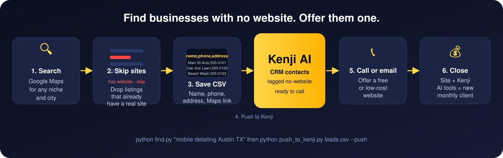
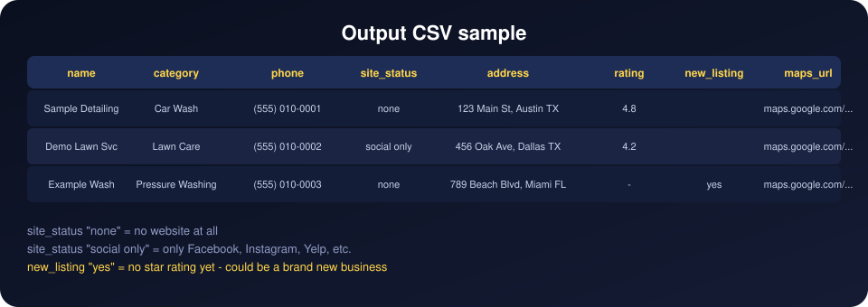
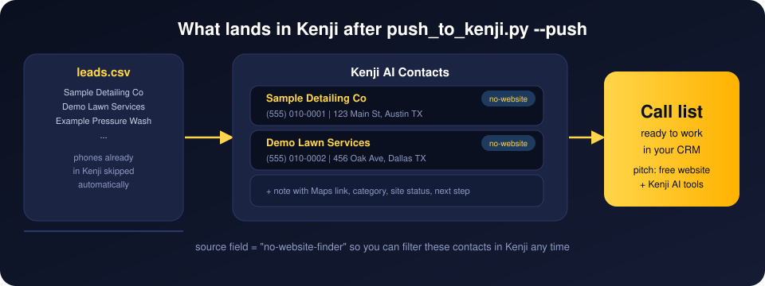
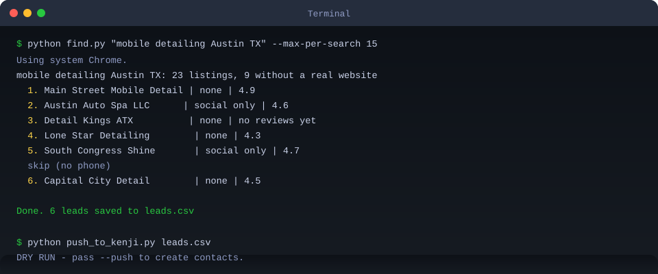
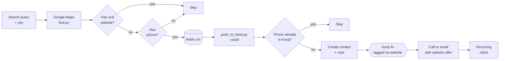

# No-Website Finder

Find local businesses on Google Maps that have no website, then push them into **[Kenji AI](https://kenjiai.com/?utm_source=github&utm_medium=readme&utm_campaign=no-website-finder)** as contacts so you can call or email with a website offer.



Two commands do all of it:

```bash
python find.py "mobile detailing Austin TX" "mobile detailing Miami FL"
python push_to_kenji.py leads.csv --push
```

---

## Why businesses without websites are worth calling

Plenty of local businesses still have no website. They show up on Google Maps with a phone number and nothing else. They want customers. They are reachable. They have no one helping them online.

The pitch is simple: offer a free or low-cost website to get them in the door, then show them what Kenji's AI tools do for follow-up and lead management. That is a recurring client for a few hundred dollars a month, and most agencies skip them because they only chase businesses that already have ad budgets.

This tool finds those businesses automatically. You call, you show them the preview, you close.



---

## Compliance

Read this before you run any searches.

**TCPA (US):** Cold-texting a cell phone number you scraped is a federal violation. Penalties run $500 to $1,500 per text. Call or email first. Text only after the person gives you explicit permission to do so.

**Google Terms of Service:** Google does not allow automated scraping of Maps. This tool uses a real browser with human-paced delays to stay low-impact, but you are responsible for how you use it. Keep batches small (20 to 50 listings per run), add extra delay with `--delay 3` on slow days, and do not run it in a tight loop. If Google shows a "unusual traffic" page the script stops automatically.

**Data use:** The information the script collects is public business listing data: business names, phone numbers, and addresses that the businesses themselves submitted to Google. Use it only for direct, one-to-one outreach to those businesses. Do not sell, publish, or bulk-upload this data to ad platforms.

---

## Part 1: Set up Kenji AI (one time, about 10 minutes)

Kenji is the CRM where the contacts land. You push leads in once, and they are ready in your pipeline to call or sequence through email.



### Step 1. Get your Kenji account

1. Sign up here: **https://freedom.kenjiai.com/finishhere?utm_source=github&utm_medium=readme&utm_campaign=no-website-finder**
2. You will get your login by email. Log in at **https://app.kenjiai.com**
3. Want help setting it up, or want us to run outreach for you? Book a call: **https://go.mediatraffics.com/leads?utm_source=github&utm_medium=readme&utm_campaign=no-website-finder**

### Step 2. Create your API key

1. In Kenji, go to **Settings > Private Integrations**.
2. Click **Create new integration** and name it `No-Website Finder`.
3. Turn on these scopes:

   | Scope | What it is for |
   |---|---|
   | `contacts.write` | Create the contacts |
   | `contacts.readonly` | Search for duplicates before creating |

4. Copy the key. It starts with `pit-`. Kenji only shows it once, so save it now.
5. Find your **Location ID**. It is in your browser's address bar while logged in:
   `https://app.kenjiai.com/v2/location/`**`THIS_PART_IS_YOUR_LOCATION_ID`**`/dashboard`

Treat the key like a password. Do not share it or commit it to GitHub. The `.env` file it goes in is already excluded from git.

---

## Part 2: Install

You need **Python 3.10+**.

| | Windows | Mac | Linux |
|---|---|---|---|
| Python | [python.org/downloads](https://www.python.org/downloads/) (tick "Add to PATH") | `brew install python` | `sudo apt install python3 python3-pip` |

```bash
git clone https://github.com/yousiful/no-website-finder.git
cd no-website-finder
pip install -r requirements.txt
playwright install chromium
```

Copy `.env.example` to `.env` and fill in your key and Location ID from Part 1:

```
KENJI_API_KEY=pit-xxxxxxxx-xxxx-xxxx-xxxx-xxxxxxxxxxxx
KENJI_LOCATION_ID=your_location_id
```

---

## Part 3: Find leads

Each argument is a complete search query. Put the niche and city together in one quoted string.

```bash
# Single query
python find.py "mobile detailing Austin TX"

# Multiple cities in one run
python find.py "mobile detailing Austin TX" "mobile detailing Houston TX" "mobile detailing San Antonio TX"

# Multiple niches in one run
python find.py "lawn care Dallas TX" "pressure washing Dallas TX"

# From a text file (one query per line, same format)
python find.py --queries-file queries.txt

# Cap at 20 listings per search to stay safe
python find.py "auto glass Phoenix AZ" --max-per-search 20

# Show the browser window (useful for debugging)
python find.py "locksmith Denver CO" --headful

# Slower delay between requests
python find.py "electrician Seattle WA" --delay 3
```

Results append to `leads.csv` by default. If the file already exists, the script resumes where it left off and skips any Maps URL it already has.



### Output columns

| Column | What it means |
|---|---|
| `name` | Business name from Google Maps |
| `category` | Category label, e.g. "Mobile Auto Detailing" |
| `phone` | Phone number as shown on Maps |
| `site_status` | `none` (no website listed) or `social only` (Facebook/Yelp/Instagram only) |
| `website` | The social URL, if one was found |
| `address` | Full address string |
| `rating` | Average star rating from Maps |
| `new_listing` | `yes` when the listing has no rating yet |
| `maps_url` | Direct Maps link for the listing |

### A note on batch size

Google is more likely to serve a CAPTCHA after 50 to 100 listings in one session. Keep `--max-per-search` at 20 to 30 when doing multiple queries in one run. If you hit a block, the script stops and tells you. Wait a few hours before trying again.

---

## Part 4: Push to Kenji

```bash
# See what would happen without sending anything
python push_to_kenji.py leads.csv

# Create the contacts for real
python push_to_kenji.py leads.csv --push

# Dry run against the sample file
python push_to_kenji.py examples/sample.csv
```

Dry run is the default. You have to pass `--push` to actually create contacts.

The script checks each phone number against your Kenji account before creating anything. Phones already in Kenji are skipped, so running it twice on the same file is safe. Each new contact gets:

- Tags: `no-website` and `maps-finder`
- Source: `no-website-finder`
- A note with the Maps link, category, site status, and a one-line outreach reminder

The script never enrolls contacts in workflows. It never sends messages.

---

## Outreach approach

Once the contacts are in Kenji, the next step is a phone call or a cold email, not a text.

Call script outline:

> "Hey, I found your business on Google Maps. I noticed you don't have a website yet. We help local businesses like yours get online and start picking up calls from Google. I'd love to show you a quick preview. Is now a good time, or is [time] better?"

If they want a preview, build a simple one-page site on a staging URL and send it after the call. Do not text without permission.

Email works too. Keep it short: one line about how you found them, one line about the offer, one question. Skip the pitch deck for the first message.

After they say yes to seeing more, that is when Kenji's follow-up sequences, appointment booking, and AI tools come in.

---

## Full flow



---

## Fixing common problems

| Problem | Fix |
|---|---|
| `Playwright is not installed` | Run `pip install playwright && playwright install chromium` |
| `System Chrome not found` | That is fine. The script falls back to Playwright's bundled Chromium automatically. |
| Google stopped after a few searches | You hit a rate limit. Add `--delay 3` and keep `--max-per-search` at 20 or below. Wait a few hours if the script stops with a "unusual traffic" message. |
| `Set KENJI_API_KEY and KENJI_LOCATION_ID` | Copy `.env.example` to `.env` and fill in your values from Part 1. |
| `contacts.write: 401 or 403` | Your key does not have the `contacts.write` scope. Delete it and create a new one with the right scopes. |
| Duplicate contacts | The script checks phones before creating. If duplicates appeared, the contact was under a different phone format. File an issue. |
| `No results feed for: ...` | Google returned no results for that query. Try a broader term or check the query in a browser first. |

---

## More free tools

- **[kenji-clip-engine](https://github.com/yousiful/kenji-clip-engine)** - Turn any YouTube video or Zoom recording into short vertical clips, then post them to Facebook, Instagram, TikTok, LinkedIn and more through Kenji.
- **[reel-editing-toolkit](https://github.com/yousiful/reel-editing-toolkit)** - Animated captions, zoom cuts, cue cards and sound effects for reels.

---

MIT License.
